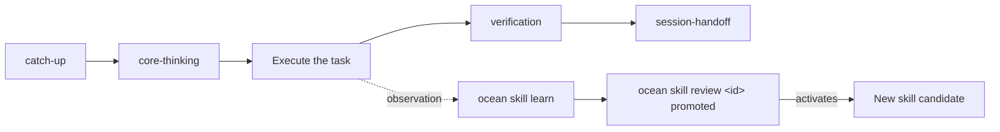

# Ocean

**One workspace for every AI agent you use.** Ocean is a local-first operating layer that
runs Claude, Codex, Gemini, Antigravity, and Hermes as headless agents over the same
projects, tasks, memory, and knowledge — on your machine, without a hosted service.

## The idea

Every AI client keeps its own memory, its own history, and its own idea of what you were
doing. Switch from one to another and the context is gone; come back next week and the
decisions are buried in a chat log nobody will reread.

Ocean moves that state out of the clients and into one place you own. Projects, tasks,
decisions, sessions, and evidence live as plain files in a private workspace on your disk.
Every client — whichever model, whichever vendor — reads from and writes to that same
workspace through one runtime. The client becomes the hands; Ocean is the memory and the
rules.

Like an ocean connects every shore, Ocean connects every agent to the same body of work: a
task started in Claude can be continued in Codex, reviewed in Gemini, and closed from the
terminal, with nothing re-explained.

## Philosophy

- **Local-first.** Your records are files on your machine. No account, no server, no sync
  service in the middle. Ocean works offline and never needs to phone home.
- **The record is the truth.** A task declares its own status in its own file. Boards,
  indexes, and summaries are generated from the records and checked for drift — never
  hand-edited, never authoritative.
- **Storage is not context.** An agent receives a small, bounded packet of what the work
  needs, loaded in layers, not the whole workspace. Less noise, lower cost, better answers.
- **Provider-neutral.** No model is special. Providers are entry points that can be added,
  swapped, or removed; the workspace outlives any of them.
- **Explicit authority.** Reads are free. Writes, promotions, pushes, and merges need an
  explicit approval, and the approval is recorded. Nothing is promoted or published
  implicitly.
- **Verified, not claimed.** A provider saying "done" is not evidence. Completion is an
  independent check passing, and the result records what was verified versus assumed.
- **Public engine, private life.** This repository holds code, tests, and templates only.
  Your records, governance, and machine state live in a separate private workspace and
  never enter it. Ocean never stores provider credentials.

## Quick start

Install the published package when available:

```bash
npm install --global ocean
ocean setup
```

After installation, `ocean` opens a short first-run wizard automatically when the private
workspace does not exist. Use `ocean --yes` for the recommended non-interactive defaults.

For a local checkout, use the development commands below instead.

```bash
git clone https://github.com/amoree-code/ocean.git ocean
cd ocean
pnpm install
pnpm build
node packages/harness/dist/main.js setup
```

By default, `setup` creates the Ocean workspace as a private sibling directory next to
this repository (e.g. `ocean/` next to `ocean/kernel/`), not inside it, and installs
user-level startup integration pointed at this repository's `packages/harness/dist/main.js`.
Later logins start the local runtime automatically. Set `OCEAN_ROOT` to use a different
workspace location instead.

## Using Ocean

Run an agent:

```bash
ocean run --profile default --prompt "Review this project"
```

Open a provider through Ocean's managed PTY boundary when interactive use is required:

```bash
ocean client open hermes
ocean client open claude
ocean client status
```

`ocean run` is the full-head path. Direct provider commands remain transparent
terminal-shim compatibility paths with an explicitly recorded `observed` control level.
See the [entry-point contract](docs/entry-points.md).

Inspect, resume, or promote a saved session:

```bash
ocean session list
ocean session show <session-id>
ocean session resume <session-id> "Continue the review"
ocean session promote <session-id> knowledge/results --approve
```

Promotion is explicit: it copies a bounded, redacted provider result into private Ocean
knowledge and records the source session. It never promotes a session implicitly.

Continue the same task from any registered client with a compact Ocean-owned handoff:

```bash
ocean handoff create --task T-193 --next "Run verification"
ocean handoff context <handoff-id>
ocean run --profile reviewer --client codex --task T-193 --handoff <handoff-id> --prompt "Continue"
```

Capture ideas and start the day without a provider subscription:

```bash
ocean idea save "Short title" "Raw idea text"
ocean capture add "An idea to review later"
ocean capture list
ocean capture promote <id> knowledge/results
ocean daily start
```

Keep the workspace healthy:

```bash
ocean doctor            # read-only health check (add --json for machine output)
ocean repair            # safe repair preview
ocean repair --apply    # apply only after reviewing the preview
```

The installed provider must be available on `PATH`. Ocean does not store provider
credentials.

### Obsidian

Connect an Obsidian vault during setup, or later:

```bash
ocean setup --obsidian /path/to/Obsidian
ocean obsidian connect /path/to/Obsidian
ocean obsidian discover
ocean obsidian sync
```

The connection is read-only by default. Use `--read-write` only when Ocean is explicitly
allowed to write notes. The local runtime watches the connected vault while
`ocean service` is running.

### MCP

Expose the workspace and vault tools to any AI client through a provider-neutral stdio
MCP server:

```bash
ocean mcp config
ocean mcp gateway-config
ocean obsidian mcp
```

`ocean mcp config` prints the client configuration; it does not write into client-owned
configuration files or store credentials. The Ocean MCP server exposes read-only workspace
tools, resources, and review prompts. Local `stdio` clients provide the connection
consent; Ocean keeps write and execution approval inside its policy boundary.

## Agent skills

Ocean ships provider-neutral Agent Skills under `packages/harness/skills/core/`, invoked
by name from any registered client. The core loop:

- `catch-up` — reconstruct project state, completed work, blockers, and the next action.
- `core-thinking` — separate facts from assumptions and choose the smallest valid
  solution before executing.
- `verification` — turn an implementation claim into a focused, repeatable check.
- `session-handoff` — produce a compact continuation packet for the next session.

Alongside them: `business-logic`, `design-thinking`, `graft`, `loop`, and `use-browser`.
See [skills/index.json](packages/harness/skills/index.json) for the current catalog.

Skills are not hand-authored from scratch: `ocean skill learn <completed-session-id>`
extracts a candidate from a finished session, and `ocean skill review <candidate-id>
promoted` reviews and activates it.



## Repository layout

```text
ocean/                          private workspace root (local only, never published)
├── kernel/                     THIS repository — the public Ocean engine (pnpm workspace)
│   ├── packages/
│   │   ├── harness/            the `ocean` CLI package — interfaces, providers, skills
│   │   ├── services/           browser, Obsidian, workspace doctor, MCP servers
│   │   ├── loop/               tasks, handoffs, runs, sessions, the session store
│   │   ├── context/            context ladder, bounded packets, intent routing
│   │   ├── brain/              memory, evidence, capture, brain index
│   │   ├── market/             skills catalog and MCP marketplace
│   │   └── core/               domain types, ports, shared path and task helpers
│   ├── docs/
│   └── scripts/
├── 00-inbox/ … 06-templates/   private user, project, and knowledge records
├── charter/                    private governance: core rules and policies
└── bridge/                     machine-local state: profiles, sessions, config, integrations
```

Only `kernel/` is this repository. The records, `charter/`, and `bridge/` are siblings in
the private workspace and are not part of it. Each package may import only the packages
below it; `pnpm check:deps` enforces the order. See [Architecture](docs/architecture.md).

## Development

```bash
pnpm install
pnpm build
pnpm test
pnpm check
```

The test suite uses local processes and temporary SQLite databases. It does not invoke a
real provider or require an API key.

Build and run the isolated test image:

```bash
docker build -t ocean-test .
docker run --rm ocean-test
```

The image validates the Ocean engine and test suite. Provider CLIs and their credentials
remain on the host and are not included in the image.

## Releases

Ocean is versioned as one unit — every package shares the version in its
`package.json`. Releases are published as **Ocean vX.Y.Z** on the
[releases page](https://github.com/amoree-code/ocean/releases). Every pull request adds a
line under **Unreleased** in the [changelog](CHANGELOG.md); a release moves those lines
under its version.

## Documentation

- [Operating model](docs/operating-model.md) — ownership, request flow, and the provider boundary
- [Architecture](docs/architecture.md) — packages, layers, and the public/private boundary
- [Workspace](docs/workspace.md) — layout, path resolution, and `ocean setup`
- [Profiles](docs/profiles.md) — schema, loading, and the default profile
- [Sessions](docs/sessions.md) — storage, status lifecycle, and CLI usage
- [Providers](docs/providers.md) — supported providers and how they are invoked
- [Context](docs/context.md) — how the prompt context is assembled and bounded
- [MCP](docs/mcp.md) — the MCP servers and the gateway
- [Security](docs/security.md) — credentials, the workspace boundary, and access control
- [Publishing](docs/publishing.md) — how the public export is checked and pushed
- [Troubleshooting](docs/troubleshooting.md) — common errors and how to resolve them
- [Migration](docs/migration.md) — what changes between versions and how to move a workspace
- [Changelog](CHANGELOG.md) — what changed, per release

## License

Ocean is open source under the [MIT License](LICENSE).
