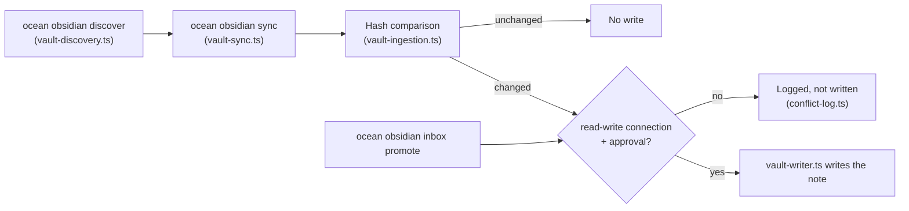

# Ocean MCP connection

Ocean exposes the governed Obsidian tools through one provider-neutral stdio MCP server. Generate the native client configuration with:

```sh
ocean mcp config
```

Copy the returned `mcpServers` object into the MCP configuration of each approved AI client. The same generated entry works for Claude, Codex, Gemini, Hermes, and other clients that support stdio MCP; only the client-owned configuration location differs.

The server also exposes bounded read-only continuity surfaces: `ocean_task_get`,
`ocean_handoffs_list`, `ocean_handoff_get`, `ocean_session_get`, and `ocean_session_events`,
plus the `ocean://handoffs` resource (`ocean://status`, `ocean://profiles` and `ocean://tasks` are
also listed).
The server identifies itself as `ocean` in `initialize` `serverInfo`. Tool and prompt names are `ocean_*`. The generated config entry is keyed `ocean` (`mcpServers.ocean`) — that key is the client-owned identity of an installed entry, so re-running setup never adds a second server. A client still holding an entry under the legacy key from an older release should remove it. Every client receives the same Ocean-owned metadata; provider-native
transcripts and credentials are not copied between clients. The Obsidian vault server is keyed
`ocean-obsidian`; it never takes the `ocean` key, which belongs to the brain server.

## Memory contract (T-296)

`initialize` returns `instructions`: the same memory contract for every client (Ocean is the
memory; search before answering; explicit saves with `memory_write`; inferred or imported facts
with `memory_propose`; never secrets). `ocean_capabilities` reports the contract version and
whether writes are on; `ocean_ping` is a cheap health check.

| Tool | Effect |
| ---- | ------ |
| `memory_read` | one record with its `sha256` |
| `memory_history` | audit entries, newest first; ids feed `memory_restore` |
| `memory_write` | `create` (refuses an existing or same-name/same-title record unless `allowSimilar`) or `update` (needs `expectedHash`); the replaced content is kept |
| `memory_propose` | a server-named candidate under `00-inbox/candidates/<date>/`, for review |
| `memory_delete` | soft delete into trash; needs `expectedHash` |
| `memory_restore` | puts back a deleted record or an earlier version |

Writable roots, fixed in `packages/brain/src/memory/memory-paths.ts`: records under
`02-personal/**` and `04-projects/<id>/memory/**` (caller-chosen, `.md`, never an index or
`CONFLICTS.md`); candidates, versions, trash, the audit log and the client journal (server-named,
under `00-inbox/candidates/` and `bridge/state/`). A symlink or hard link on the way, a path
outside these roots, a known secret shape or more than 32 KB is refused. Errors carry a stable
`error.data.code` (`EXISTS`, `EXISTS_SIMILAR`, `MISSING`, `OUT_OF_ROOT`, `PROTECTED`, `SYMLINK`,
`HARDLINK`, `SECRET`, `CONFLICT`, `TOO_LARGE`, `INVALID`, `WRITES_OFF`).

Nothing is hard-deleted over MCP. `ocean memory purge` (CLI) lists stored copies older than the
retention period and removes them only with `--yes`. `bridge/config/memory.json` holds
`{"mcpWrites": "on" | "off", "retentionDays": 90}`; `off` refuses every mutating tool.

Tool annotations (`readOnlyHint`, `destructiveHint`) are hints for a client's permission UI, not
enforcement: whether a client asks before a call is the client's behaviour and is not assumed.
The server's own checks above are what bound a call.

The server reads the private connection at `OCEAN_ROOT/bridge/integrations/obsidian/connection.json`. It never receives provider credentials. Keep the connection `read-only` until the client route is verified. Mutating tools require both client approval and an explicit `read-write` connection.

## Wiring every client: `ocean clients` (T-296)

`ocean clients detect|plan` lists every AI client and IDE Ocean knows (installed ones, with the
evidence), its tier (`supported`, `context-file`, `unsupported`, `unknown`), the pending change to
its `ocean` entry, its native-memory policy, and the reason or fallback for clients that cannot
connect. `ocean clients apply` prints the plan; `--yes` writes it. Only Ocean-managed entries are
touched: `ocean` (set to `node <current engine> mcp serve`), a legacy `ocean` that runs the Obsidian
server (renamed `ocean-obsidian`), and dead entries of the retired atlas gateway. An entry with keys
Ocean does not manage (`env`, headers, a TOML sub-table), a JSON file not in canonical form, or a
YAML list is never rewritten: it becomes a manual step with the exact entry to add.

Each write re-reads the file right before replacing it (a concurrent edit makes Ocean recompute),
keeps the file's mode and writes through a symlink. Rollback uses
`bridge/state/clients/journal.jsonl` (mode 0600): the before/after value of each managed entry
only — never a copy of a client file — and a value that holds a credential shape is kept as a hash,
so restoring it can only remove Ocean's entry. `ocean clients restore [--batch <id>]` undoes an
apply; an entry the user changed since is reported as a conflict and left alone. `ocean clients
repair` (run by `ocean client sync`) re-applies only clients approved by an earlier `apply --yes`.
`ocean clients verify [<id>]` starts each client's configured command and checks it answers as the
brain server — proof the entry launches, not that the app connects. `ocean doctor` fails for an
installed supported client that is not wired or needs a manual edit, warns for an unknown
capability, and reports unsupported clients with their fallback.

## One endpoint for every server: the MCP gateway

`ocean mcp gateway` is a single stdio MCP server that routes the tools of every registered
server. Print its client entry (keyed `ocean-gateway`) with:

```sh
ocean mcp gateway-config
```

- **Members:** the engine's first-party servers (`dev.ocean/ocean`, `dev.ocean/obsidian`) and
  every MCP server installed with `ocean market install`. An installed server is started by the
  same launcher as `ocean market exec`: declared permissions, only its declared environment
  variables, inside the macOS sandbox. A third-party server joins only by being installed, never
  by editing a client config. Remote servers are not proxied; the gateway logs their URL.
- **Names:** tools are exposed as `<server>__<tool>`, for example `ocean__ocean_status` or
  `obsidian__obsidian_read`.
- **Runtime scan:** each tool's name, its description, and every key and string inside its input
  schema (property names, titles, enum values, defaults) are scanned with the same rules as an
  install. A flagged tool is hidden and the finding is logged.
- **Writes:** the gateway adds no authority and removes none. A call reaches its server with
  exactly the arguments the client sent. So a server's own approval check (such as
  `ocean_session_promote`'s fingerprint) decides as it would on a direct connection, and the
  client's permission prompt stays the human gate.
- **Failures:** a server that exits or does not answer within 15 s is left out and logged.
  The other servers keep working. A server that dies later is not restarted; its calls fail
  until the client restarts the gateway.

Logs go to stderr, which MCP clients keep as the server's log. Each member's own stderr lines
are labelled `ocean mcp gateway [<capability>]`.

## Obsidian sync flow

`ocean obsidian discover` and `ocean obsidian sync` run read-only by default; a write only
happens when the connection is explicitly `read-write` and the caller (client or MCP tool)
approves it.


