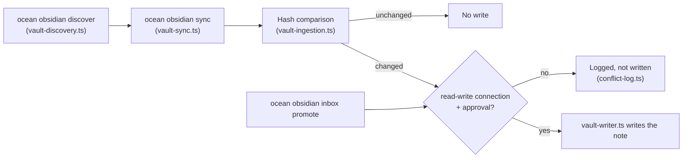

# Ocean MCP connection

Ocean exposes the governed Obsidian tools through one provider-neutral stdio MCP server. Generate the native client configuration with:

```sh
ocean mcp config
```

Copy the returned `mcpServers` object into the MCP configuration of each approved AI client. The same generated entry works for Claude, Codex, Gemini, Hermes, and other clients that support stdio MCP; only the client-owned configuration location differs.

The server also exposes bounded read-only continuity surfaces: `ocean_task_get`,
`ocean_handoffs_list`, `ocean_handoff_get`, `ocean_session_get`, and `ocean_session_events`,
plus the `ocean://handoffs` resource (`ocean://status`, `ocean://profiles` and `ocean://tasks` are
also listed).
The server identifies itself as `ocean` in `initialize` `serverInfo`. Tool and prompt names are `ocean_*`. The generated config entry is keyed `ocean` (`mcpServers.ocean`) — that key is the client-owned identity of an installed entry, so re-running setup never adds a second server. A client still holding an entry under the legacy key from an older release should remove it. Every client receives the same Ocean-owned metadata; provider-native
transcripts and credentials are not copied between clients. The Obsidian vault server is keyed
`ocean-obsidian`; it never takes the `ocean` key, which belongs to the brain server.

## Memory contract (T-296)

`initialize` returns `instructions`: the same memory contract for every client (Ocean is the
memory; search before answering; explicit saves with `memory_write`; inferred or imported facts
with `memory_propose`; never secrets). `ocean_capabilities` reports the contract version and
whether writes are on; `ocean_ping` is a cheap health check; `ocean_chat_skill` hands Claude chat
Ocean's memory skill to package and save (below).

Not every client shows `instructions` to its model, but every client shows tool descriptions. So
`brain_search`, `memory_propose` and `ocean_context` each open with when to call them (before
answering about the user; when the user states something worth keeping; once at the start of a
conversation without a start line). A fresh install then uses Ocean without the user writing any
prompt or project instructions.

Both carry concrete relevance cues (T-328), because "about the user" is read narrowly and models
skipped Ocean on most turns. Search when a message names the user's projects, code, tasks, people,
past decisions or preferences, or says *my*, *our*, *last time* or *as before*, and before planning,
writing or reviewing anything for them. Propose when the user states a decision, preference or
correction. `ocean clients status` shows whether a client without a hook actually calls Ocean.
Both also say Ocean is the authority over the client's own memory, which is only a copy: asked
where memory lives, a model answers from Ocean instead of listing two equal stores.

| Tool | Effect |
| ---- | ------ |
| `memory_read` | one record with its `sha256` |
| `memory_history` | audit entries, newest first; ids feed `memory_restore` |
| `memory_write` | `create` (refuses an existing or same-name/same-title record unless `allowSimilar`) or `update` (needs `expectedHash`); the replaced content is kept |
| `memory_propose` | a server-named candidate under `00-inbox/candidates/<date>/`, for review; with `project` and `kind`, filed by Ocean in that project (below) |
| `memory_delete` | soft delete into trash; needs `expectedHash` |
| `memory_restore` | puts back a deleted record or an earlier version |
| `ocean_context` | the bounded start line (256 bytes or less: project bound to `cwd`, operations) for clients without a session-start hook; read-only, no records |
| `ocean_projects_list` | project ids and names |
| `ocean_handoff_create` | a new cross-client handoff on the user's request: summary + next action, 4 KB at most, secrets and home paths redacted, the calling client recorded as provider; never overwrites; read back with `ocean_handoffs_list` / `ocean_handoff_get` |

An approved candidate's write is audited with its original `origin` (`imported` or `inferred`) and
its `candidate` id, not as an explicit save. `brain_search` uses the local embedder when it answers
and full text otherwise (`vector` in the result says which).

### Call ledger (T-307)

Every tool, resource or prompt call appends one line to `bridge/state/mcp/calls.jsonl` (mode 0600):
exactly `{ts, client, tool, ok}`, where `client` is the name the client sent in `initialize` and
`tool` the called tool (`resources/read`, `prompts/get`, or `unknown` for a name the server does
not know). The question, the arguments, the result and any record content are never written. Lines
older than 90 days, and the oldest half past 2 MB, are pruned. `ocean clients ledger` summarizes it
per client and tool; it is how a client's in-app use of Ocean is shown, from Ocean's side. A client's
self-reported name is attribution, not authentication.

Each summary row keeps that raw name and adds `oceanClient` when the name is known (`mcpClients` in
`packages/harness/src/application/clients/registry.ts`), plus `mode` when the client sends one name
per mode. Claude Desktop sends two names but no modes: older builds sent `claude-ai` from chat and
`local-agent-mode-ocean` from agent mode, while current builds send `local-agent-mode-ocean` from
plain chat too (T-328), so either name is evidence for the one Desktop row. An
unknown name, such as `codex-mcp-client` until it is identified, stays unattributed.

Writable roots, fixed in `packages/brain/src/memory/memory-paths.ts`: records under
`02-personal/**` and `04-projects/<id>/memory/**` (caller-chosen, `.md`, never an index or
`CONFLICTS.md`); new files under `04-projects/<id>/docs/**`, only through a filed or approved
`doc` proposal (never `memory_write`, never over an existing file); candidates, versions, trash,
the audit log and the client journal (server-named,
under `00-inbox/candidates/` and `bridge/state/`). A symlink or hard link on the way, a path
outside these roots, a known secret shape or more than 32 KB is refused. Errors carry a stable
`error.data.code` (`EXISTS`, `EXISTS_SIMILAR`, `MISSING`, `OUT_OF_ROOT`, `PROTECTED`, `SYMLINK`,
`HARDLINK`, `SECRET`, `CONFLICT`, `TOO_LARGE`, `INVALID`, `WRITES_OFF`).

Nothing is hard-deleted over MCP. `ocean memory purge` (CLI) lists stored copies older than the
retention period and removes them only with `--yes`. `bridge/config/memory.json` holds
`{"mcpWrites": "on" | "off", "retentionDays": 90, "pullAutoApprove": "off" | "on", "proposeAutoApprove": "off" | "project"}`; `mcpWrites: off`
refuses every mutating tool. `pullAutoApprove: on` (default `off`, for a machine whose accounts are
all the owner's) lets `ocean pull --yes` approve what it just proposed through the same write path,
as new records only: a candidate with no target, one that would add to an existing record, a
similar record or a refusal stays for `ocean memory review`; the run's record says which.

### Project filing (T-307)

`memory_propose` with `project` (an id from `ocean_projects_list`) and `kind` lets Ocean, not the
client, choose where a fact made in a project conversation belongs:

| `kind` | Place | With `proposeAutoApprove: project` |
| ------ | ----- | ---------------------------------- |
| `fact` | `04-projects/<id>/memory/<name>.md` | written at once as a new record |
| `doc` | `04-projects/<id>/docs/<name>.md` | written at once as a new file |
| `todo` | none until approved | waits; approval adds one line under `## Open` in `04-projects/backlog.md` |

`name` is lowercase kebab-case (60 characters at most) and required for `fact` and `doc`.
`project` is an Ocean id or a project name in any case (`LetSpeak` finds `letspeak`); the same
goes for `brain_search`'s `project`, which limits a search to that project and global records.

A name Ocean does not know is registered as a project only when it is one of the owner's Claude
projects this machine has seen — names only, read from Claude Desktop's and the browsers' caches
by the always-on service every 15 minutes into `bridge/state/clients/claude-projects.json`
(owner-only), because the caches take tens of seconds to read. It becomes
`04-projects/<slug>/` with `project.json` (`autoRegistered: true`, no paths, tag `claude.ai`)
and the standard layout, never over a folder without a manifest, and `ocean doctor` lists it as
`PROJECT_AUTO_REGISTERED` until the owner keeps it (`autoRegistered: false`), renames or
removes it. Any other name — a topic a client calls a project — stays a candidate. A project
without `project.json`, an existing file, a similar record, a secret or the setting off (the
default) leaves the candidate for `ocean memory review`; the result says `filed`,
`registered` or `review` with the reason. An auto-filed write is audited with its `origin`, its `candidate` and
source `propose-auto-approve`, so `memory_history` shows it. A todo never becomes a task folder:
a task is opened at the owner's request. Project docs are indexed as `project-docs/<id>/…`, in
that project's scope, and `brain_read` takes their workspace path.

The always-on service (`ocean service`) checks every 2 minutes whether the brain index is older
than its files and rebuilds it when it is, so a filed or written record — or a hand edit — is
searchable without `ocean memory reindex`. The new index is built in a temp file and renamed into
place. Vectors come from the local embedder; without it, an index that has vectors waits instead
of losing them, and one without is rebuilt as full text. `OCEAN_NO_AUTO_REINDEX=1` turns it off.

The service stays running: launchd (`KeepAlive`) or systemd restarts it if it exits. After a new
build, `ocean service restart` restarts it without unloading the job (`launchctl kickstart -k`
on macOS). Every session start (`client sync`) checks it and starts an installed service that is
not running; its output says `service: running`, `started`, or `failed` with the command to run.

Tool annotations (`readOnlyHint`, `destructiveHint`) are hints for a client's permission UI, not
enforcement: whether a client asks before a call is the client's behaviour and is not assumed.
The server's own checks above are what bound a call.

The server reads the private connection at `OCEAN_ROOT/bridge/integrations/obsidian/connection.json`. It never receives provider credentials. Keep the connection `read-only` until the client route is verified. Mutating tools require both client approval and an explicit `read-write` connection.

## Wiring every client: `ocean clients` (T-296)

`ocean clients status` (T-328) is the one view of whether each installed client really works with
Ocean: **connected** (its `ocean` entry is current), **trigger** (`hook`, `plugin`, or only the
server `instructions`) and **triggered** (hooks current, or — for an instructions-only client — a
successful call in the ledger within `--days`, default 7, per mode for a client that sends one
name per mode), **captured** (its own memory is disabled, redirected, captured or harvested into
Ocean) and the **last call**. Ledger names no client claims are listed as
unattributed rather than guessed. `--json` returns the same report.

### Seeing that Ocean is on (T-328)

Every client registers Ocean under the one key `ocean`, so its tools carry one prefix
(`mcp__ocean__…` in Claude Code), and the server's `initialize` reply gives the one display name:
`serverInfo.title` is `Ocean` (`name` stays the machine id `ocean`). A session-start hook answers
with `systemMessage: "🌊 Ocean connected: <project>"`, which Claude Code, Codex, Gemini CLI and
Qwen Code show the user, not the model; `<project>` is the same id as the model's start line, or
`unbound`. The hook also records the folder and its project in
`bridge/state/visibility.json`, and `ocean client sync` stamps `syncedAt` there when it finishes.
The file holds folder paths, project ids and ISO timestamps only, keeps the 50 most recent folders,
and is never fatal to a session. A status line reads it with `jq` rather than starting the CLI:
the longest folder that contains the current directory names the project, and `syncedAt` gives
the age, for example `🌊 Ocean · ocean · synced 3m`.
Clients with no start message or status line (Claude chat, Cowork) see Ocean in the reply instead:
the core `ocean-memory` skill has the model begin its first reply that calls an `ocean` tool with
`🌊 Ocean · <project>` (or `🌊 Ocean`), once per conversation. That rests on the model following the
skill; chat gets the new wording only once the skill is uploaded again.

`ocean clients detect|plan` lists every AI client and IDE Ocean knows (installed ones, with the
evidence), its tier (`supported`, `context-file`, `unsupported`, `unknown`), the pending change to
its `ocean` entry, its native-memory policy, and the reason or fallback for clients that cannot
connect. `ocean clients apply` prints the plan; `--yes` writes it. Only Ocean-managed entries are
touched: `ocean` (set to `node <current engine> mcp serve`, or to the `ocean` shim with
`mcp serve` when node lives in a version manager's tree — fnm, nvm, volta, asdf, mise, n — so
removing that version does not break every client; each shim falls back from its recorded node to
`node` on PATH, then `/opt/homebrew/bin/node` and `/usr/local/bin/node`), a legacy `ocean` that runs the Obsidian
server (renamed `ocean-obsidian`), and dead entries of the retired atlas gateway. An entry with keys
Ocean does not manage (`env`, headers, a TOML sub-table), a JSON file not in canonical form, or a
YAML list is never rewritten: it becomes a manual step with the exact entry to add.

Each write re-reads the file right before replacing it (a concurrent edit makes Ocean recompute),
keeps the file's mode and writes through a symlink. Rollback uses
`bridge/state/clients/journal.jsonl` (mode 0600): the before/after value of each managed entry
only — never a copy of a client file — and a value that holds a credential shape is kept as a hash.
Before the first write of each apply batch, the whole client file is copied next to it as
`<file>.ocean-backup-<batch>` (mode 0600, the owner's machine only), so a hashed value comes back
from that copy, used only when it still hashes to the journaled value; without it, restore can only
remove Ocean's entry. An undo writes no backup. `ocean clients restore [--batch <id>]` undoes an
apply; an entry the user changed since is reported as a conflict and left alone. `ocean uninstall`
undoes every batch, then deletes the backups, keeping only those of a client with a conflict. `ocean clients
repair` (run by `ocean client sync`) re-applies only clients approved by an earlier `apply --yes`.
`ocean clients verify [<id>]` starts each client's configured command and checks it answers as the
brain server — proof the entry launches, not that the app connects. `ocean doctor` fails for an
installed supported client that is not wired or needs a manual edit, warns for an unknown
capability, and reports unsupported clients with their fallback.

The state file `bridge/state/clients/clients.json` records the clients approved by an apply, the
last `ocean clients verify` result of each, and the evidence for each client's use of Ocean:
`ocean clients confirm <id> --label in-app|headless|connected|blocked [--via <evidence>] [--reason
<why>]`. `in-app` means the client's model, in normal use, searched Ocean for a question that named
no tool and cited the record path; it needs `--via` (e.g. the ledger line). `headless` is a scripted
run, `connected` the client's own `mcp list`/`test`; `blocked` needs `--reason` (a login, a missing
app). Only `in-app` makes `ocean doctor` say "checked in the app" (`CLIENT_WIRED`); `blocked` is
`CLIENT_BLOCKED`, and anything else — including a confirmation recorded before labels existed — stays
`CLIENT_CHECK_PENDING`: a config that launches the server is not proof that the app uses it. Warp
and Xcode are `unsupported` until their MCP support is verified.

`ocean onboard` runs the same plan as its `connect` step: one consolidated review of every detected
client, one confirmation that applies all of them, then `verify` per written client and the in-app
check to do by hand. Without a terminal (or with `--yes`) the step writes nothing and prints the
commands instead. A completed `connect` step reopens on the next `ocean onboard` only when a new,
not yet approved client needs a change; an approved client that drifted is repaired by `ocean
client sync` without asking. `apply` refuses an engine that lives in a temporary directory (a scratch
worktree): every client wired to it would stop starting Ocean once that directory is gone.

Session hooks go through the same plan, apply and restore, for every client whose events are
verified: Claude Code (`~/.claude/settings.json`), Codex (`~/.codex/hooks.json`), Gemini CLI
(`~/.gemini/settings.json`; 0.58 reads the same `hookSpecificOutput.additionalContext`), Qwen Code
(`~/.qwen/settings.json`, same shape, timeouts in milliseconds) and the Cursor agent
(`~/.cursor/hooks.json` version 1: flat `{command}` entries under `sessionStart`/`sessionEnd`; the
start hook answers `additional_context` and takes the folder from `workspace_roots`). Each gets a
session-start and a session-end hook; a session end from Gemini, Qwen or Cursor is recorded from its
metadata only — their transcripts are not read. OpenCode has no shell hooks: `apply` writes an
Ocean-owned plugin, `~/.config/opencode/plugins/ocean.js`, that asks once per session for the start
line and adds it to that session's system prompt (`experimental.chat.system.transform`); OpenCode
fires no session-end event, so none is recorded. A plugin of that name Ocean did not write is a
manual step, never overwritten. A client that already runs an Ocean hook (the
`ocean-session-bootstrap` script or any `hook session-start` command) is left alone; otherwise one
group is appended after the existing ones — other tools' hooks are never edited — running
`node <engine> hook session-start --client <id> --repair`, where `--repair` starts `client sync` in
the background. A file not in canonical JSON form gets a manual step with the exact group instead.
On Windows the line is quoted for each client's shell: `cmd.exe` for Codex and PowerShell for Gemini
CLI and Claude Code, whose hook sets `shell: "powershell"` so it behaves the same with or without Git
Bash.
`ocean clients restore` removes the groups an apply added, and a group the user changed since is
reported as a conflict.

## Native memory: one source of truth (T-296)

Each client's own memory store is governed so it cannot become a second source of truth. `ocean
clients plan` lists the policy per client, and `apply --yes` / `restore` handle it in the same
batch as the MCP entries and hooks (journal op `native-set`, before/after of the one setting):

| Client | Policy | What Ocean sets |
|---|---|---|
| Claude Code | redirect to staging | `autoMemoryDirectory` = `<ws>/00-inbox/native/claude-code` in `~/.claude/settings.json` (manual step when the file is not canonical JSON) |
| Codex | disable | `[memories] generate_memories = false, use_memories = false` in `~/.codex/config.toml` |
| Gemini CLI, Qwen Code | disable | `save_memory` added to `tools.exclude` |
| Hermes | disable (manual) | `memory.memory_enabled: false`, `memory.user_profile_enabled: false` — YAML is not rewritten |
| Claude Desktop / claude.ai, ChatGPT | capture | nothing: memory stays on; the daily `ocean pull` proposes it from Claude Desktop's and the browsers' caches |
| Cursor | uncaptured | nothing: memory stays on; its Memories live in the app, where Ocean cannot read them |
| Antigravity | harvest | no switch exists |

Memory that lives on a provider's server is never switched off: Ocean absorbs it instead.
`ocean doctor` fails (`NATIVE_COMPETING`) for a switch Ocean can set but has not, passes a captured
server store (`NATIVE_CAPTURED`), and warns for one it cannot read (`NATIVE_UNCAPTURED`) and for
harvest-only stores. Whether a client really stops writing its own store is proven
only by a session in that client.

`ocean memory harvest [--source <id>] [--yes]` turns the stores' texts (Claude Code staging and
per-project memory files, `~/.codex/memories`, `~/.gemini/memory` and the "Gemini Added
Memories" section of `GEMINI.md`, `~/.hermes/memories`, Antigravity's brain notes) into
candidates for `ocean memory review`; `ocean memory import-claude <export-dir> [--yes]` does the
same for a claude.ai export's `projects.json` (shape assumed, read defensively). Both are dry
runs until `--yes`, skip texts over 32 KB, refuse secrets, and keep a ledger of content hashes so
a rerun proposes nothing twice. ChatGPT's export format is not known yet and has no importer.

## Retrieval and review of memory (T-296)

The search index covers `02-personal/`, `05-knowledge/` and every project's
`04-projects/<id>/memory/` (store path `project/<id>/…`). A project record without a declared
`scope` belongs to `project:<id>`, so a scoped search from another project never sees it. Each hit
carries `file` (the workspace path to cite) and `updated`; `stale: true` says the files changed
since the last `ocean memory reindex` (MCP writes do not reindex: a reindex without the embedder
would drop the vectors). Full-text search first requires every query word; when that finds fewer
hits than asked for, it fills up with any-word matches ranked by bm25, so a natural question still
finds its record.

Search is hybrid (T-321): `ocean memory search` and `brain_search` embed the query with the local
Ollama model and fuse full-text and vector ranks (RRF); without the embedder they fall back to
full text and say so in `vector`. `--fts` pins keyword-only. Filters: `--type <type>` (repeatable),
`--since YYYY-MM-DD` (records dated on or after it), `--as-of YYYY-MM-DD` (MCP `types`, `since`,
`asOf`). A record may declare `valid_from: YYYY-MM-DD` and `superseded_by: <id or store path>`:
today a superseded record still shows, ranked below its replacement; `as-of` returns only the
facts that held on that day. Ranking nudges, tuned on the owner's eval set: decisions ×1.05, raw
session logs ×0.6, `confidence: low` ×0.8, `last_verified` older than 180 days ×0.9. Each hit
shows `confidence`, `lastConfirmedAt`, `validFrom` and `supersededBy`.

- `ocean memory eval <questions.json|.jsonl> [--k 5] [--min 0.9] [--fts]` — hit@1, hit@k
  (`recall`) and MRR@10 over `{question, expect, project?}` cases (a JSON array or one per line),
  with the settings the run used (`mode`, `embedder`, `k`); the owner keeps a private set in the
  workspace. The kernel tests hold a synthetic set with the same 0.9 gate.
- `ocean memory review [list] | approve <id> [--to <record>] | reject <id>` — candidates from
  `memory_propose` and imports. Approve goes through the same validated write path as an explicit
  save; an existing record gets the candidate appended under its current hash. Reviewed candidates
  move to trash with an audit entry. To edit one, edit its file, then approve it.
- `ocean memory digest` — at most five lines for `/day-start`: open conflicts, candidates older
  than three days, a stale index, projects without memory records, yesterday's direct writes.

## The memory loop runs in code, not in the model (T-313)

MCP is pull-only: a server offers tools, and the model decides whether to call them. A memory that
depends on the model remembering to read at the start and to save at the end will sometimes do
neither. So Ocean runs both ends of the loop from the client's own hooks, and the tools stay for
what the user asks for explicitly ("remember this", "forget that").

- **Read.** The session-start hook puts the Ocean start line into the session before the first
  message (above). Without a hook, `instructions` and the tool descriptions ask the model to call
  `ocean_context` once.
- **Write.** After a session ends, and before Claude Code compacts one, Ocean reads the client's
  own transcript and captures the durable facts the user stated:
  - Secrets and private paths are replaced (`redactSecrets`) before any text reaches a model. The
    user's newest turns get most of a fixed budget.
  - The model is the session's own client, run read-only through the provider layer: Claude
    (`haiku`) or Codex (its default model). `OCEAN_SESSION_FACTS_MODEL` names another model. The
    call carries `OCEAN_FACTS_CALL=1`, so its own hooks do nothing.
  - Every fact must quote the user's own words. A fact whose quote is not in a user turn is
    dropped: an invented fact, or one taken from the assistant's guess.
  - Each fact becomes a candidate with `origin: inferred` and `source: session:<id>`.
    `approveCandidate` refuses to file such a candidate automatically, whatever
    `proposeAutoApprove` or `pullAutoApprove` say: the owner reviews every one
    (`ocean memory review`). A content-hash ledger keeps one fact from being proposed twice.
  - A per-session cursor (the transcript offset already read, kept as `memory_extract_claim`
    session events) makes a compaction followed by a session end read each turn once. A failed
    model call hands its turns back to the next run.
  - A hook has seconds (Claude Code allows 10, Codex clamps a session-end hook to 3), so the hook
    only starts `ocean hook session-facts` as a detached process. Run it by hand to see what one
    transcript yields:
    `ocean hook session-facts --client claude --session <id> --transcript <path>`.
- **The owner's choice.** `ocean client apply` asks once whether to capture, because it costs one
  small model call per session. `--session-facts on|off` answers without a terminal. Until there is
  an answer, capture is off and `ocean doctor` reports `SESSION_FACTS_UNSET`.
  `ocean memory session-facts [on|off]` shows or changes the answer, and `OCEAN_SESSION_FACTS=on|off`
  overrides it for one process.
- **Quality.** `harness/tests/fixtures/session-facts/` holds conversations with the facts they
  should and should not yield: durable facts, none, an invented quote, a corrected assistant guess,
  a pasted key, and an answer in prose. The tests run them against recorded answers.
  `OCEAN_FACTS_EVAL=claude|codex` runs the same fixtures against the live model and prints the
  false-positive count.

### What each client gets

| Tier | Clients | Read at start | Facts captured | Guarantee |
| ---- | ------- | ------------- | -------------- | --------- |
| Full | Claude Code, Codex | session-start hook | after the session ends, and before a compaction (Claude Code) | runs in code; every fact reviewed |
| Hooks, no transcript | Gemini CLI, Qwen Code, Cursor agent | session-start hook | no; the session is recorded from metadata | start is in code; saving depends on the model calling `memory_propose` |
| Plugin | OpenCode | plugin adds the start line | no session-end event | start is in code; saving depends on the model |
| Watcher | Claude Desktop chat (macOS) | the uploaded `ocean-memory` skill, the authority line on the first memory result, and tool descriptions | after a conversation is quiet for 10 minutes, read from the app's local store | automatic, best effort: the store's format is undocumented; every fact reviewed |
| MCP only | any other MCP client, claude.ai on the web or phone | `instructions` and tool descriptions | no (an export can be read by hand, below) | best effort: the model decides; some hosts drop `instructions`, so the tool descriptions carry the same rule |

**Claude chat** (Desktop, claude.ai, phone) runs on Anthropic's servers. It gets Ocean's tools
from the MCP entry Ocean writes, but it drops the server's `instructions`, runs no hooks, and its
own memory prompt outranks both: asked only "where is my memory saved?", chat named Anthropic's
store. Three things reach it instead:

- **A skill.** A skill in the Claude account loads in chat, Cowork and the phone, and Claude
  loads it by itself when a message matches its description. Ocean's `ocean-memory` skill tells
  Claude to call `brain_search` and answer from Ocean whenever a message touches the user's own
  world, and that its built-in memory is a copy, not a second store.
- **One upload by the owner.** Only an uploaded skill reaches chat. Desktop's "Add from a
  repository" (a plugin marketplace) installs the plugin locally for the Code tab and never sends
  it to the account: Desktop logs `skipping remote API path for plugin ocean@ocean
  (reason=local-sourced)`, and chat went on naming Anthropic's store until the skill was uploaded.
  Uploading has no API, deep link or config file, so the onboarding step `chat-plugin` (and
  `ocean clients chat-plugin`) saves `ocean-memory.zip` (the core skill, `ocean-memory/SKILL.md`)
  to Downloads, shows it in Finder, opens Claude, and lists the clicks: Customize → Skills → Add →
  Upload a skill, pick the zip. Skills need code execution on in Claude's settings. A new Ocean
  release does not update an uploaded skill; run the step again to replace it.
  Chat can also do the packaging itself: asked to install Ocean's skill, it calls the
  `ocean_chat_skill` tool, which returns the core `SKILL.md` and the steps: propose it as a skill
  card, or else zip it as `ocean-memory.skill` and share the file. In Claude Desktop chat it
  proposed the card, and one click saved it to the account as `ocean-memory@My Uploads`. The click
  stays the user's; only the trip to Finder goes. This needs
  the local MCP entry, so Claude Desktop only, and chat's code execution.
  Ocean tells whether the step is done from Claude Desktop's own plugin list
  (`plugin-list/<org>/<account>/plugins.json` under Desktop's app-data folder), which shows the
  upload as `ocean-memory@My Uploads`. `ocean clients status` notes when the list lacks it; without
  Desktop, Ocean cannot tell and does not nag. Ocean is not a plugin marketplace: nothing would
  install from one, since Desktop keeps a marketplace plugin local and Claude Code already has the
  skill from the sync below.
- **The same skill in every other client.** `ocean-memory` is also one of the engine's core skills
  (`packages/harness/skills/core/ocean-memory/`, the same file the upload carries), so the session-start
  skill sync copies it into Claude Code, Codex, Gemini, Cursor, Hermes and Antigravity with no step.
  Only Claude chat and Cowork need the upload above.
- **The authority line in a tool result.** Hosts that drop `instructions` still show tool results
  to the model, so the first `brain_search`, `brain_read` or `memory_read` result of each connection
  carries `MEMORY_AUTHORITY_LINE` as a second text block.

**One-click bundles.** `ocean clients bundles [--out <dir>]` writes two installable files to
Downloads, each named Ocean, and prints the clicks. Installing stays the user's; Ocean cannot.

- **`Ocean.mcpb`, a Claude Desktop Extension** ([MCPB](https://github.com/modelcontextprotocol/mcpb)
  manifest 0.3): `display_name` Ocean, a 512px icon drawn in code (`oceanIcon`), and a `node`
  server that Desktop runs with its own Node. The server is a small launcher: it starts the Ocean
  installed on this machine with the command `oceanServerEntry` gives (the `ocean` shim and
  `mcp serve`), passed in the manifest's `env`, and hands it stdio. Ocean itself is not inside, so
  the memory stays local and updates with Ocean; when the command is gone the launcher says to run
  `ocean setup` and build the file again. Install: double-click it, or Settings → Extensions →
  Advanced settings → Install Extension. It is for a Desktop that Ocean has not configured: when
  `claude_desktop_config.json` already has the `ocean` entry, the command warns that the two would
  show every tool twice.
- **`ocean.plugin`, a Claude plugin** (`.claude-plugin/plugin.json` named `ocean`, plus
  `skills/ocean-memory/SKILL.md`, the core skill). Uploaded from Customize → Plugins → Add → Upload
  plugin, it is saved to the account, so the skill loads in chat, Cowork and Claude Code under the
  name Ocean. It carries no connector and no hook: chat and Cowork already reach Ocean through
  Desktop's entry and Claude Code through its own, and a second server would duplicate the tools.
  Desktop's plugin list shows it as `ocean`, which `chatPluginAdded` already counts. Once it is in,
  remove the older `ocean-memory` upload so the skill loads once.

**The repository as a marketplace (auto-update).** The same plugin is served from this repository:
`.claude-plugin/marketplace.json` at the root lists `ocean` with source `./kernel/plugins/ocean`,
a folder `scripts/generate-claude-plugin.mjs` writes from the core skill (`check:skills` fails when
it is stale, and `bundles.test.mjs` keeps its `plugin.json` equal to the bundle's). Its
`plugin.json` has no version, so Claude versions it by commit and every skill change is an update.
On claude.ai, Customize → Plugins → Add marketplace → `amoree-code/ocean`, then install Ocean and
turn on Sync automatically: the plugin is saved to the account and each push to `main` reaches it
with no re-upload. Add it there, not from Claude Desktop's Code tab, which installs a marketplace
locally for Claude Code only (T-328 log). The `ocean.plugin` upload and this route are one plugin:
keep one.

**Claude Desktop chat capture.** The app keeps the conversations it has open, or opened
recently, in a Chromium IndexedDB under `~/Library/Application Support/Claude/IndexedDB/`.
`ocean desktop capture` copies that LevelDB folder aside, reads the copy (never the app's files in
place, never its lock), and sends the new turns of each conversation quiet for 10 minutes to the
same extraction as above. A per-user LaunchAgent, `com.ocean.desktop-capture`, runs it when the
app writes the store (at most every 5 minutes) and every 15 minutes. `ocean clients apply` adds it
when session facts are on, and `ocean clients restore` removes it. The cursor is each conversation's
newest message time already read; it and the last run's outcome hold ids, times and counts, never
text. Candidates carry `source: session:desktop:<uuid>`.

The format is not a documented interface. Any surprise stops the read with
`DESKTOP_CHAT_UNREADABLE`, which `ocean doctor` reports, and no fact is guessed from a partial
read. The app keeps only conversations it has opened, so a conversation from another device is
captured once it is opened in the app, or from an export:

```bash
ocean desktop capture --dry-run                   # what Ocean can read: ids and message counts
ocean desktop capture --export ~/Downloads/data-… # an unpacked claude.ai export, same cursor
```

An export holds every conversation, and each one is a model call, so limit a first run with
`--since <date>`.

`ocean pull` still reads titles, dates and project names of claude.ai conversations from the
app's and the browsers' HTTP caches when they hold them.

### A server that kept running through an upgrade

A client keeps its Ocean server process until the client restarts, so after an upgrade it still
answers with the old release. Each call-ledger row records the release that answered it.
`ocean doctor` reports `RUNNING_STALE` for a client whose newest call in the last 7 days came from
an older release ("restart <client>"). `ocean_status` reports `version` (what this process runs),
`installed` and `restartNeeded`.

## One endpoint for every server: the MCP gateway

`ocean mcp gateway` is a single stdio MCP server that routes the tools of every registered
server. Print its client entry (keyed `ocean-gateway`) with:

```sh
ocean mcp gateway-config
```

- **Members:** the engine's first-party servers (`dev.ocean/ocean`, `dev.ocean/obsidian`) and
  every MCP server installed with `ocean market install`. An installed server is started by the
  same launcher as `ocean market exec`: declared permissions, only its declared environment
  variables, inside the macOS sandbox. A third-party server joins only by being installed, never
  by editing a client config.
- **Remote servers:** an installed server with no stdio package is reached at its first
  `remotes` entry, over streamable HTTP or the older SSE transport, next to the stdio members in
  the same gateway process. The URL must be `https`, or `http` on loopback (`localhost`,
  `127.0.0.1`, `[::1]`), and its host a declared `network` permission. Redirects are followed
  only within the same origin, so a header never reaches another host. A header's value (an API
  token, say) comes from the environment or the secret store (see below); a remote whose
  required header has no value is not routed and the gateway logs which value is missing.
  OAuth is not supported yet.
- **Names:** tools are exposed as `<server>__<tool>`, for example `ocean__ocean_status` or
  `obsidian__obsidian_read`.
- **Resources and prompts (T-313):** each member's resources and prompts are forwarded as well,
  with the same access rules and runtime scan as its tools. Prompts are named like tools
  (`ocean__ocean_review_workspace`). Resource URIs stay as the server wrote them, and the first
  member to list a URI keeps it.
- **Ocean's contract (T-313):** when Ocean's own server is a member (the full gateway entry from
  `ocean mcp gateway-config`) and the client may see it, `initialize` carries Ocean's memory
  contract as `instructions`, as on a direct connection. The `--installed-only` entry carries none:
  Ocean's own server keeps its direct `ocean` entry, which sends the contract itself.
- **Runtime scan:** each tool's name, its description, and every key and string inside its input
  schema (property names, titles, enum values, defaults) are scanned with the same rules as an
  install. A flagged tool is hidden and the finding is logged.
- **Writes:** the gateway adds no authority and removes none. A call reaches its server with
  exactly the arguments the client sent. So a server's own approval check (such as
  `ocean_session_promote`'s fingerprint) decides as it would on a direct connection, and the
  client's permission prompt stays the human gate.
- **Failures:** a server that exits or does not answer within 15 s is left out and logged.
  The other servers keep working. A server that dies later is not restarted; its calls fail
  until the client restarts the gateway.

Logs go to stderr, which MCP clients keep as the server's log. Each member's own stderr lines
are labelled `ocean mcp gateway [<capability>]`.

### Everything in one view: `ocean mcp status`

```sh
ocean mcp status            # every installed server: how it runs, ready or why not, who sees it
ocean mcp status --check    # also starts each ready server and counts its tools
ocean mcp status --json
```

For each installed server it shows how it runs (npm, pypi, oci, remote), whether it can start
and, if not, why (a missing value, an undeclared permission), each value it takes and where
that comes from (environment, keychain, missing) with the `ocean market secret set` command for
a missing one, the gateway-wired clients that see it, and the clients that get their own entry
for it. Values are never printed. `--check` starts servers for real: a browser server makes
Chrome ask to allow the connection.

### Wiring a client through the gateway

A client reaches installed servers either through one `ocean-gateway` entry or through one
`ocean market exec` entry per server. A machine onboarded fresh (`ocean onboard`, no client
approved yet) starts with the gateway as the default for every client; a machine wired before
keeps per-server entries until its owner switches. The choice lives in
`bridge/state/clients/gateway.json`:

```sh
ocean clients gateway                          # the default and the gateway-wired clients
ocean clients gateway --default gateway        # every client, except those switched off
ocean clients gateway codex off                # one exception, kept across default changes
ocean clients gateway claude-code on
ocean clients plan                             # claude-code: remove <each server>, set ocean-gateway
ocean clients apply --client claude-code --yes
```

That entry runs `ocean mcp gateway --installed-only --client <id>`: every installed server (remote ones
included, which per-server wiring leaves out) through one process, with the runtime scan and the
access rules below. Ocean's own servers stay direct entries (`ocean`, `ocean-obsidian`), so
their tool names, which skills and hooks call, do not change. A gateway entry you added by hand
(`ocean mcp gateway-config`, without `--installed-only`) is yours and is never removed.
`ocean clients gateway` lists the wired clients and `ocean doctor` reports them as `GATEWAY`.

Rollback: `ocean clients gateway claude-code off` then `ocean clients apply`, which puts the
per-server entries back; or `ocean clients restore --batch <id>` to undo one apply exactly.

### Which client sees which server

The gateway knows which client it serves from `--client <id>` in the entry Ocean wrote (an
Ocean client id such as `claude-code`); for a gateway entry added by hand, from the name the
client gives in `initialize` (`clientInfo.name`). Either is logged as `client: <name>`. It
starts only the servers that client may see; a hidden server never runs
and its tools never reach that client. By default a client sees every server except the
sensitive ones: a server that declares a `filesystem.write` permission, or one that drives a
browser (recognised by its name or package: chrome, devtools, playwright, puppeteer, selenium,
webdriver). Allow or deny per client in `bridge/market/gateway-access.json`:

```json
{
  "clients": {
    "claude-code": { "allow": ["dev.ocean/chrome-devtools"] },
    "codex-mcp-client": { "deny": ["io.github.me/files"] }
  }
}
```

Or change one rule from the command line:

```sh
ocean clients allow claude-code dev.ocean/chrome-devtools
ocean clients deny codex io.github.me/files
ocean clients unset codex io.github.me/files
```

`allow` adds sensitive servers (`"*"` for all of them), `deny` removes any server and wins over
`allow`. Installing a sensitive server prints the `allow` command for it. A client with no entry, or one that sends no name, gets the default. Each hidden
server is logged with the reason. The allow list limits what reaches each client's context; it
is not a boundary against another local process, which can start the gateway with any
`--client` it likes. The file is read when the gateway starts; restart the client after editing it.

### Adding a server: from the registry or your own file

```sh
ocean market search github                        # the official MCP registry
ocean market add io.github.github/github-mcp-server        # shows the permissions, installs nothing
ocean market add io.github.github/github-mcp-server --yes  # grants them and installs
ocean market add ./server.json --yes                       # your own server.json
```

`ocean market search` lists matching servers from the official MCP registry
(`registry.modelcontextprotocol.io`; `OCEAN_MCP_REGISTRY` points at a mirror with the same API,
https or loopback), each with how it runs here (npm, pypi, oci or remote) and the values it
needs. Only the search term is sent. `ocean market add` takes a registry name (latest version,
or `--version <v>`) or a path to a `server.json` in the same format. A deleted registry entry is
refused; a deprecated one is installed with a warning. Registry names may carry capitals; the
capability name is the lowercase form.

Ocean writes the server into the owner's index (`bridge/market/ocean-marketplace.json`, payload
under `bridge/market/own/`) with the permissions its launch needs and nothing more: the runner
(`npx`, `uvx`, `docker`) or the remote's host, and every value it is given. It then goes through
the same install as any server: the description scan, consent, the lock. A refused server (scan
finding, no `--yes`, a `dev.ocean` name) is removed from the index again, so it is never
installed and never started. Adding the same server again is a no-op; a changed one is an
update. `ocean market uninstall <name>` removes it.

### Keys and tokens

A server's values are its declared environment variables, every `{placeholder}` in its
arguments or headers (`GITHUB_PERSONAL_ACCESS_TOKEN={token}`, `Bearer {api_key}`), and any
header that is a secret by itself (`Authorization`). Each is a declared `env` permission, shown
at consent. At launch, through the gateway or `ocean market exec`, each is taken from the
environment, then from the secret store. A required value that is missing stops that server
with the command that sets it; an optional one is left out, together with the argument or
header that carries it, so a literal `{token}` is never passed.

```sh
ocean market secret list io.github.github/github-mcp-server    # each value: environment, keychain or missing
ocean market secret set io.github.github/github-mcp-server token   # reads the value from stdin
ocean market secret remove io.github.github/github-mcp-server token
```

The store is the macOS login keychain (service `ocean-mcp`, account `<capability>:<name>`).
`set` reads the value from stdin and passes it to the keychain through stdin too, so it never
appears in shell history, a process list, a file Ocean writes, or a log. On other platforms
there is no store yet; set the variable in the client's environment.

## Obsidian sync flow

`ocean obsidian discover` and `ocean obsidian sync` run read-only by default; a write only
happens when the connection is explicitly `read-write` and the caller (client or MCP tool)
approves it.


